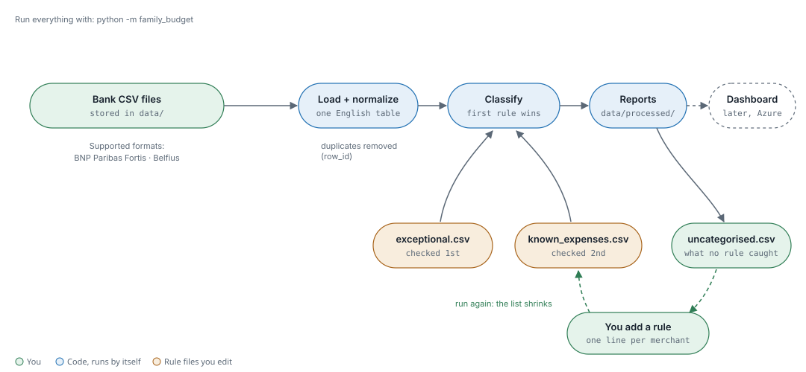
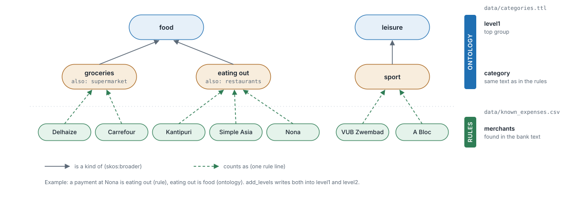
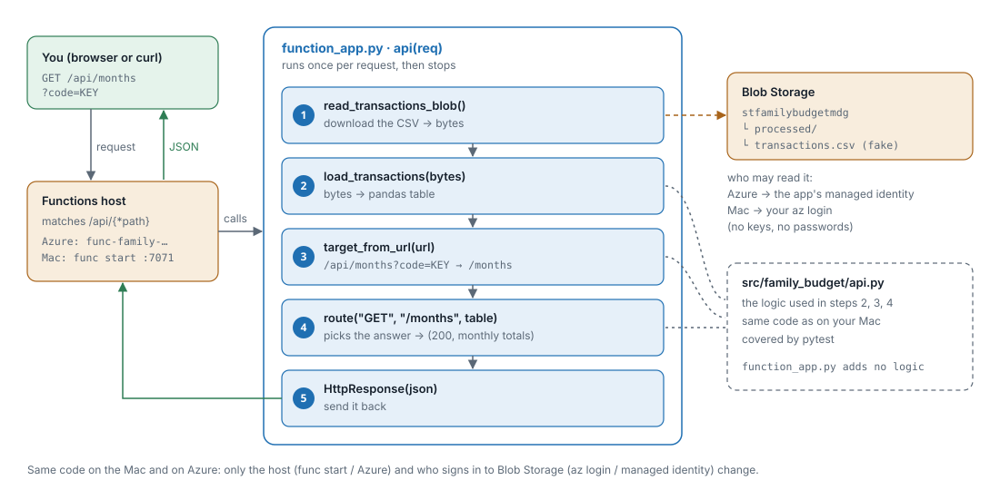

# family-budget

Turns BNP and Belfius CSV exports into categorised transactions and monthly totals
(income, fixed and variable spending, saving). One-off projects such as flat purchases
are kept out of the monthly totals and reported separately.



## Setup

```bash
python3.11 -m venv .venv && source .venv/bin/activate
pip install -r requirements-dev.txt
pip install -e .
```

## Monthly routine

1. Export the month as CSV from each bank.
2. Put the files in `data/BNP/` or `data/belfius_common/`. Overlaps are fine: duplicates are removed.
3. Run `python -m family_budget`.
4. Open `data/processed/uncategorised.csv`. For anything that repeats, add a line to
   `data/known_expenses.csv` and run again.
5. If you used a new category, add it to `data/categories.ttl` (the run lists the missing ones).

## Files

| Path | Content |
|---|---|
| `data/known_expenses.csv` | Recurring rules, edited by hand |
| `data/exceptional.csv` | One-off transactions (flats, company, moves) |
| `data/categories.ttl` | Category tree (ontology), edited by hand |
| `ontologies/places.ttl` | World → continent → region → country, names in 7 languages. General, generated from Unicode CLDR |
| `data/processed/` | Generated: `transactions.csv`, `monthly_summary.csv`, `uncategorised.csv` |
| `src/family_budget/` | Code: load, normalize, classify, summarize |
| `tests/` | `pytest`, fake data only |

`data/` is in `.gitignore`: bank data never leaves your machine.

## Normalized table

Every bank format is turned into the same table (`normalize.py`), one row per transaction.
Rules, summaries and outputs only ever use these columns:

| Column | Type | Meaning | Example (fake) |
|---|---|---|---|
| `row_id` | text | account + bank reference; unique, used to drop duplicates | `BE00000000000001-2025-00715` |
| `date` | date | day the bank executed it | `2025-09-01` |
| `amount` | number | negative = money out, positive = money in | `-61.89` |
| `account` | text | your IBAN, no spaces | `BE00000000000001` |
| `bank` | text | `bnp` or `belfius` | `bnp` |
| `transaction_type` | text | `card`, `transfer`, `direct_debit`, `loan`, `fee`, `cash`, `credit_card`, `other` | `card` |
| `counterparty` | text, may be empty | who you paid or who paid you; the shop for card payments | `DELHAIZE ROODEBE BRUXELLES` |
| `counterparty_iban` | text, may be empty | their IBAN, no spaces; empty for card payments | `BE00000000000002` |
| `owner` | text, may be empty | who made it: account holder, or cardholder on a joint account | `Marco` |
| `text` | text | communication + details in capitals; rule keywords search here | `PAIEMENT AVEC LA CARTE ...` |

Rows that are not final (refused, or pending without a reference) are dropped:
they appear with a reference in a later export.

`classify` then adds four columns: `category`, `type`, `is_fixed`, `property`.
The category tree adds `level1` and `level2`, and trips add `trip`.

## Rules

Each line of a rule file is an **IF … THEN …**:

```
transaction_type, counterparty_iban, keyword, amount, direction  →  category, type, is_fixed
└──────────── IF: input to classify (match fields) ────────────┘    └ THEN: output of classify ┘
```

- **Match fields** are compared with columns that already exist in the normalized table.
  Fill only what you need: an **empty cell matches anything**, so empty cells are normal.
- **Result fields** are copied onto the transaction by `classify`. They do not exist before it runs.
- Lines starting with `#` are comments and blank lines are ignored, so the file is split into
  commented groups (income, rental, transfers, fixed expenses, …). Group order matters.
- Rules are read top to bottom, `exceptional.csv` before `known_expenses.csv`.
  The first rule whose filled cells all match wins. Unmatched rows become `Uncategorised`.

| Column | Side | Meaning |
|---|---|---|
| `transaction_type` | IF | *how* the money moved, set by the bank via `normalize`: `card`, `transfer`, `direct_debit`, `loan`, `fee`, `cash`, `credit_card` |
| `counterparty_iban` | IF | exact IBAN |
| `keyword` | IF | text anywhere in counterparty name or details, any case |
| `amount` | IF | exact to the cent |
| `direction` | IF | `in` or `out` (optional column) |
| `date` | IF | exact day, `exceptional.csv` only |
| `category` | THEN | *what* the money was for, your own label: `groceries`, `rent`, … |
| `type` | THEN | which total it goes in: `spending`, `saving`, `income`, `transfer`, `exceptional` |
| `is_fixed` | THEN | `true` = fixed spending, `false` = variable |
| `property` | THEN | flat or house the payment belongs to, e.g. `Avroy 206` (optional column) |

`transaction_type` and `category` are different things. One category can come from several
transaction types (groceries by `card` or by `transfer`), and one counterparty can get two
categories depending on the type (PARTENA as `direct_debit` → health insurance; PARTENA
refund as `transfer` → health).

`transfer` and `exceptional` rows are left out of the monthly totals.

Rent is one category, `rent`, whichever way it goes: `type` says received (`income`) or paid
(`spending`), and `property` says which flat. Rent paid to the owner and rent received from
flatmates of the same flat then add up to its net cost.

### Example (fake data)

`known_expenses.csv`, order matters:

```csv
transaction_type,counterparty_iban,keyword,amount,category,type,is_fixed,direction
,BE00000000000009,,,own accounts,transfer,false,
,BE00000000000001,LOYER,,rent,spending,true,
,,MY COMPANY SRL,,salary,income,false,in
,,MY COMPANY SRL,,own company,transfer,false,out
direct_debit,,PARTENA,,health insurance,spending,true,
,,PARTENA,,health,spending,false,
direct_debit,,PAYPAL,-38.89,subscription,spending,true,
,,DELHAIZE,,groceries,spending,false,
,,PHARMACIE,,health,spending,false,
,,ITALIE,,travel,spending,false,
```

`exceptional.csv`:

```csv
date,transaction_type,counterparty_iban,keyword,amount,category,type,is_fixed
2019-06-27,,,NOTARY X,-180000.00,flat purchase,exceptional,false
```

Result:

| Transaction | Amount | Category | Why |
|---|---|---|---|
| direct debit PARTENA | −14.00 | health insurance (fixed) | first PARTENA rule needs `direct_debit` |
| transfer from PARTENA | +39.37 | health | first rule fails on type, second catches it; a refund lowers spending |
| direct debit PAYPAL | −38.89 | subscription | amount matches to the cent |
| direct debit PAYPAL | −12.00 | Uncategorised | amount differs |
| MY COMPANY SRL | +2,500.00 | salary | `direction = in` |
| MY COMPANY SRL | −3,000.00 | own company (transfer) | `direction = out`, not in totals |
| J. Dupont, BE00…0001, "Loyer septembre" | −850.00 | rent (fixed) | IBAN and keyword both match, case-insensitive |
| J. Dupont, BE00…0001, "Tricount balance" | −120.00 | Uncategorised | right IBAN, keyword missing |
| card DELHAIZE CORATO ITALIE | −35.11 | groceries | DELHAIZE comes before the ITALIE catch-all |
| card STAZIONE DI SERVIZIO ITALIE | −20.00 | travel | only the catch-all fits |
| card pharmacie du centre | −13.25 | health | keyword is case-insensitive |
| transfer to BE00…0009 | −1,000.00 | own accounts (transfer) | not in totals |
| NOTARY X, 2019-06-27 | −180,000.00 | flat purchase (exceptional) | exceptional.csv is checked first; not in totals |
| NOTARY X, 2019-07-15 | −500.00 | Uncategorised | date differs |
| A Friend, Wero | +24.00 | Uncategorised (income) | no rule; money in |

Monthly summary for 2025-09: income 2,524.00 · fixed 902.89 · variable 160.99 · net 1,460.12.
The transfers and the flat purchase do not appear.

## Category tree (ontology)

The rules give each transaction a **category**. The ontology says what each category is a
**kind of**, so totals can be read at any level: a payment at Nona is *eating out* (rule),
and eating out is *food* (ontology).



`data/categories.ttl` is written in Turtle with [SKOS](https://www.w3.org/TR/skos-primer/):

```turtle
fb:food a skos:Concept ; skos:prefLabel "food"@en .
fb:eating_out a skos:Concept ;
    skos:prefLabel "eating out"@en ;     # exactly the category text in the rules
    skos:altLabel "restaurants"@en ;     # synonym
    skos:broader fb:food .               # "is a kind of"
```

- One parent per category, and each English name is used once (checked when loading).
- `ontology.add_levels` adds `level1` (top group, e.g. `food`) and `level2` (next level down).
  A short path repeats its last level: `salary` → `income`, `salary`.
- A category that is not in the tree is used as its own group, and the run lists it.

## Trips

`category` says *what* the money was for; `trip` says *where and when*. They are independent:
a restaurant in Lisbon is `eating out` and `Portugal 2023`.

`data/trips.csv`, one line per trip window, first match wins:

```csv
name,start,end,country
Portugal 2023,2023-03-01,2023-03-09,Portugal
South America 2015,2015-10-01,2015-12-31,
```

A row gets the trip when it is **variable spending**, its date is in the window and, if `country`
is filled, its text names that country (French name in BNP, ISO code in Belfius). An empty
`country` takes everything in the window. Fixed costs and transfers are never tagged.
`trip_summary.csv` shows flights, accommodation, cash, eating out and other per trip.

## Local HTTP API (to study URIs)

After `python -m family_budget`, run `python -m family_budget.api` and open
<http://127.0.0.1:8000/>. Read-only JSON, served on your machine only.

| URI | Returns |
|---|---|
| `/months` | monthly summary |
| `/months/2025-09` | one month (path parameter) |
| `/transactions?month=2025-09&category=groceries&limit=10` | filtered list (query parameters) |
| `/transactions/{row_id}` | one transaction |
| `/categories/eating%20out/transactions` | a space is encoded as `%20` |
| `/trips`, `/trips/{name}` | trip summary |

Status codes: 200 OK, 400 bad parameter, 404 unknown resource, 405 not a GET.

## The API on Azure Functions

The same read-only API runs on Azure, on fake sample data for now
(`examples/transactions_sample.csv`, uploaded to `processed/transactions.csv`).



1. You open `/api/data/months?code=KEY`. The **Functions host** sends every URL under
   `/api/data/{*path}` to the `api` function. (Not a catch-all `/api/{*path}`: that
   would also take `/api/web`, the dashboard.)
2. It runs `api(req)` in `function_app.py`, which:
   1. downloads `processed/transactions.csv` from Blob Storage → bytes;
   2. `load_transactions(bytes)` turns the bytes into a table;
   3. `target_from_url` drops the `/api/data` prefix and the `?code=` key → `/months`;
   4. `route()` picks the answer, as on your Mac;
   5. sends the JSON back.

`function_app.py` adds no logic: steps 2–4 are tested code in `src/family_budget/api.py`.
Only two things change between the Mac and Azure:

| | On your Mac | On Azure |
|---|---|---|
| Who runs it | `func start` → <http://localhost:7071/api/data/months> | Function App `func-family-budget-mdg` |
| Who reads Blob Storage | your `az login` | the app's managed identity |

Run it locally:

```bash
cp local.settings.example.json local.settings.json   # once; never committed
func start
```

## Dashboard

One page with the last 12 months, spending by group, rent per property, a transaction
explorer (year, group, category, property, trip) and an Upload button. It draws its own
charts and loads nothing from other sites (`src/family_budget/static/dashboard.html`).

| | On your Mac | On Azure |
|---|---|---|
| Open | `python -m family_budget.api` → <http://127.0.0.1:8000/web/> | `https://func-family-budget-mdg.azurewebsites.net/api/web` |
| Data | your real `data/processed/transactions.csv` | `processed/transactions.csv` in Blob Storage |
| Login | none: only your Mac can reach it | Microsoft (or GitHub) account, and only the names in `ALLOWED_USERS` |
| Upload | not available | `POST /api/web/upload`: CSV only, max 1 MB, goes to `raw/` |

The login is Azure's built-in authentication (set to *allow* anonymous requests, because
Event Grid must still reach the ingest function). The dashboard routes check the
signed-in person themselves (`family_budget.web.check_login`) and refuse everyone until
`EASY_AUTH=on` is set: `bash scripts/azure.sh web you@outlook.com,wife@example.com`
(`PROVIDER=github` for GitHub accounts, listed by user name).

### Moving to real data

Only after the stranger test (another account gets 403):

```bash
bash scripts/azure.sh allow marcodigennaro@outlook.com   # add a name, keep the others
bash scripts/azure.sh reset          # delete the fake processed table (asks first)
bash scripts/azure.sh config         # data/ rules and categories.ttl -> config/
bash scripts/azure.sh upload data/BNP/<export>.csv   # or the dashboard's Upload button
```

`upload` and `config` refuse anything from `data/` until the login is on. After a
reset the dashboard says "No data yet" until the first upload.

## GitHub Actions

`.github/workflows/tests.yml`: every push runs ruff and pytest on Python 3.11; a push
to `main` that passes is published to the Function App. GitHub signs in to Azure
with OpenID Connect (no password stored anywhere): the identity `id-github-deploy` may
only publish to `func-family-budget-mdg`, and only for tokens from this repo's `main`.
One-time setup: `bash scripts/azure.sh github`.

## Development

```bash
pytest
ruff format --check . && ruff check .
python -m family_budget.places   # rebuild ontologies/places.ttl (downloads CLDR)
```
